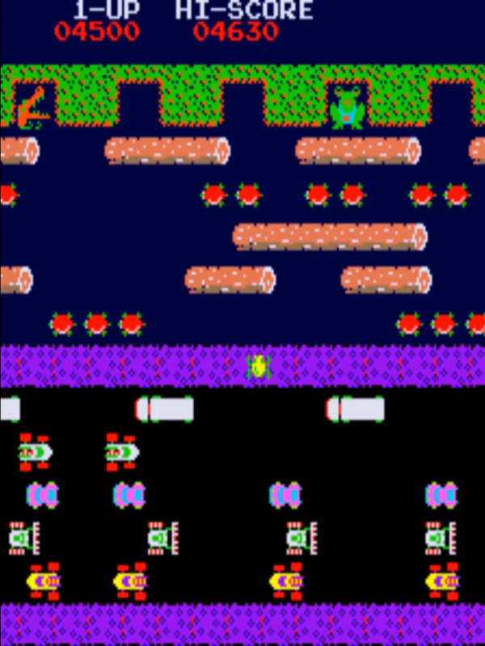

# Frogger Arcade Game



This repository contains a refactored JavaFX Frogger clone originally built as a high school project. The codebase is now organized into standard source, resource, script, and test directories so the gameplay rules are easier to follow and the project is easier to run.

## Game Logic

- The frog starts at the bottom center of the board and moves one grid step at a time.
- `WASD` and the arrow keys both work for movement.
- Reaching a new highest row awards `10` points.
- Filling an unclaimed home slot awards `50` points.
- Being hit by a vehicle or drowning costs `50` points, without letting the score go below `0`.
- The round is won after all five home slots are filled.

## Repository Layout

```text
src/
  main/
    java/com/hirish/frogger/        JavaFX application, world, actors, config
    resources/assets/               Images and audio loaded from the classpath
  test/
    java/com/hirish/frogger/        Logic-only automated tests
scripts/
  test.sh                           Runs the logic test suite
  setup-javafx.sh                   Downloads repo-local JavaFX jars
  compile.sh                        Compiles the JavaFX application
  verify.sh                         Runs tests, then compiles the app
  run-game.sh                       Compiles and launches the game
docs/
  images/gameplay.png               Screenshot used in this README
```

## Requirements

- JDK 11 or newer
- `make`
- `curl` if you want the repo to download JavaFX locally

## Quick Start

```bash
make run
```

On first run, `make run` downloads repo-local JavaFX jars into `.javafx/`, compiles the project, and launches the game.

## Common Commands

Run the logic tests:

```bash
make test
```

Run the full verification path:

```bash
make verify
```

Download JavaFX explicitly:

```bash
make setup-javafx
```

Compile without launching:

```bash
make compile
```

If you already have JavaFX installed elsewhere, you can still bypass the repo-local download and point `JAVAFX_LIB` at its `lib` directory:

```bash
JAVAFX_LIB=/path/to/javafx-sdk/lib make run
```
